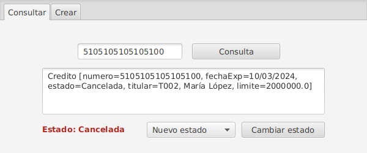
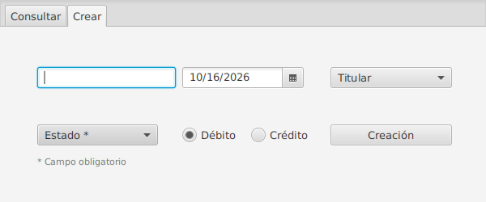
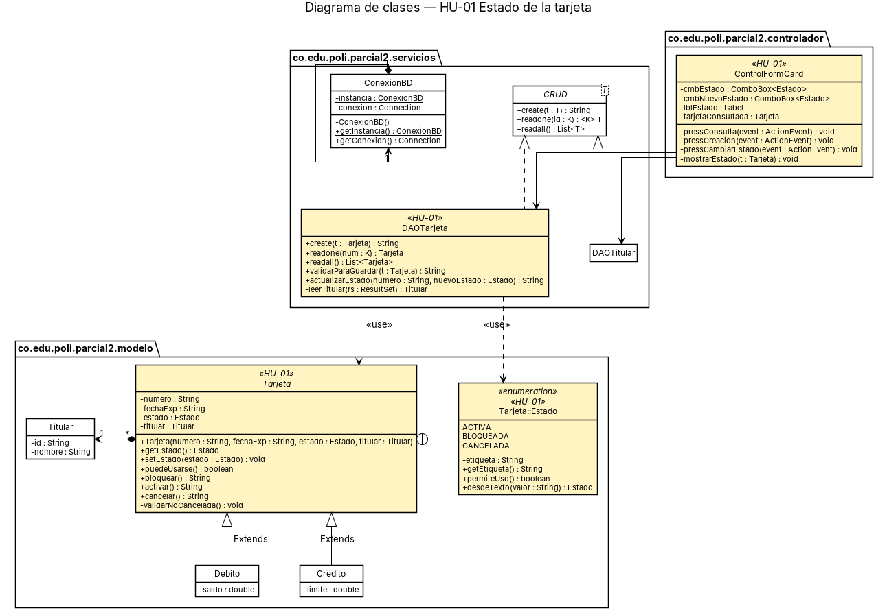

# Tarjetas — JavaFX + MySQL · HU-01 Estado de la tarjeta

Aplicación de escritorio en **JavaFX** con persistencia en **MySQL** para registrar y consultar tarjetas débito y crédito de un titular. Esta versión implementa la **HU-01**, que agrega a cada tarjeta un **estado obligatorio** (Activa, Bloqueada o Cancelada).

> 📘 En la **[Wiki](../../wiki)** del repositorio están el diagrama UML actualizado y el video de la implementación.

---

## Historia de usuario

| Campo | Detalle |
|---|---|
| **ID** | HU-01 |
| **Historia** | **Como** analista de crédito, **quiero** asignar un estado a una tarjeta **para** controlar si puede ser utilizada. |
| **Prioridad** | Alta |
| **Estimación** | **5 puntos de historia** (≈ 10 horas) |

### Criterios de aceptación

| # | Criterio | Cómo se cumple | Prueba que lo verifica |
|---|---|---|---|
| CA1 | La tarjeta puede estar **Activa**, **Bloqueada** o **Cancelada**. | Enum `Tarjeta.Estado` (anidado en `Tarjeta`) y tabla catálogo `estado_tarjeta`. | `TestEstado.existenExactamenteLosTresEstadosDeLaHU` |
| CA2 | El estado se almacena de forma **persistente** en la base de datos. | Columna `tarjeta.estado` (FK a `estado_tarjeta`); `DAOTarjeta.create`, `readone` y `actualizarEstado` la escriben y leen. | `TestDAOTarjeta.create_debito_persisteEstado`, `create_credito_persisteEstado`, `actualizarEstado_persisteElNuevoEstado` |
| CA3 | El estado se **visualiza** en el formulario principal. | Pestaña *Consultar*: etiqueta "Estado: …" con color por estado y en el detalle de la tarjeta. | `TestTarjeta.toString_contieneDatosYEstado` |
| CA4 | El estado es **obligatorio** al crear una tarjeta. | Pestaña *Crear*: `ComboBox` "Estado *" sin valor preseleccionado; el controlador no deja continuar sin él. | `TestTarjeta.constructor_sinEstado_lanzaExcepcion` |
| CA5 | **No** es posible guardar una tarjeta sin un estado válido. | Tres capas: el modelo rechaza `null`, el DAO valida antes del SQL y la BD rechaza estados vacíos o inexistentes (`NOT NULL` + FK). | `TestTarjeta.setEstado_null_…`, `TestEstado.desdeTexto_rechaza…`, `TestDAOTarjeta.baseDeDatos_rechazaTarjetaSinEstado`, `baseDeDatos_rechazaEstadoInvalido` |

**¿Por qué el enum está dentro de `Tarjeta`?** El estado solo tiene sentido como parte de una tarjeta, así que se declara como `Tarjeta.Estado`. Al ser un tipo `public static` anidado, el DAO, el controlador y las pruebas lo usan con `import co.edu.poli.parcial2.modelo.Tarjeta.Estado;`.

**Regla de negocio adicional:** una tarjeta **Cancelada** es una baja definitiva; no puede volver a activarse ni bloquearse (`Tarjeta.activar()` / `bloquear()` lanzan `IllegalStateException`).

### Estimación

Estimada con *Planning Poker* (escala Fibonacci) en **5 puntos de historia**: toca todas las capas de la aplicación (modelo, base de datos, DAO, vista y controlador) y requiere migrar datos existentes, pero la lógica es sencilla.

| Actividad | Horas |
|---|---:|
| Análisis y diseño (UML, modelo de datos) | 1.5 |
| Modelo: enum `Tarjeta.Estado` y cambios en `Tarjeta`/`Debito`/`Credito` | 1.5 |
| Base de datos: script y migración | 1.0 |
| DAO: persistencia del estado y actualización | 1.5 |
| Vista y controlador (FXML) | 1.5 |
| Pruebas unitarias y de integración | 2.0 |
| Documentación (JavaDoc, README, Wiki) | 1.0 |
| **Total** | **10.0** |

### Tareas técnicas

- [x] **T1** · Crear el enum `Estado` dentro de la clase `Tarjeta` (`ACTIVA`, `BLOQUEADA`, `CANCELADA`) con etiqueta legible, `permiteUso()` y `desdeTexto()`.
- [x] **T2** · Cambiar el atributo `estado` de `Tarjeta` de `boolean` a `Tarjeta.Estado`, validar que no sea `null` y agregar `cancelar()` y `puedeUsarse()`.
- [x] **T3** · Actualizar los constructores de `Debito` y `Credito`.
- [x] **T4** · Base de datos: crear la tabla catálogo `estado_tarjeta`, cambiar `tarjeta.estado` a `VARCHAR(10) NOT NULL` con FK y actualizar los datos de prueba (`ScriptDB.sql`).
- [x] **T5** · Escribir `MigracionHU01.sql` para bases existentes (convierte `1 → ACTIVA`, `0 → BLOQUEADA`).
- [x] **T6** · `DAOTarjeta`: guardar y leer el estado como texto, `validarParaGuardar()` y `actualizarEstado()`.
- [x] **T7** · `formCard.fxml`: `ComboBox` de estado obligatorio en *Crear*; etiqueta de estado y cambio de estado en *Consultar*.
- [x] **T8** · `ControlFormCard`: validar el estado obligatorio, mostrar el estado con color y aplicar el cambio de estado.
- [x] **T9** · Pruebas unitarias (`TestEstado`, `TestTarjeta`, `TestDAOTarjetaValidacion`) y de integración (`TestDAOTarjeta`).
- [x] **T10** · Documentar con JavaDoc y actualizar el diagrama UML de clases.

---

## Capturas

| Consultar (estado visible y cambio de estado) | Crear (estado obligatorio) |
|---|---|
|  |  |

## Diagrama de clases



Fuente PlantUML: [`docs/diagrama-clases.puml`](docs/diagrama-clases.puml). Los elementos resaltados en amarillo (`<<HU-01>>`) son los nuevos o modificados.

---

## Tecnologías

- Java 11+ · JavaFX 13 · FXML
- MySQL 8 · JDBC (`mysql-connector-j`)
- Maven · JUnit 5 · `dotenv-java`

## Estructura

```
JavaFxMySQL/
├── ScriptDB.sql            ← script completo de la base (v2.0, HU-01)
├── MigracionHU01.sql       ← migración para bases creadas con la versión anterior
├── docs/                   ← diagrama UML y capturas
└── parcial2/
    ├── .env.example
    ├── pom.xml
    └── src/
        ├── main/java/co/edu/poli/parcial2/
        │   ├── modelo/        Tarjeta (con el enum Estado), Debito, Credito, Titular
        │   ├── servicios/     CRUD, ConexionBD, DAOTarjeta, DAOTitular
        │   ├── controlador/   ControlFormCard
        │   └── vista/         App
        ├── main/resources/…/formCard.fxml
        └── test/java/…/tests/
            ├── unitaria/      TestEstado, TestTarjeta, TestDAOTarjetaValidacion
            └── integracion/   TestDAOTarjeta, TestDAOTitular
```

## Cómo ejecutar

**1. Base de datos.** Base nueva:

```bash
mysql -u root -p < ScriptDB.sql
```

Si ya tenía la base de la versión anterior, ejecute solo la migración:

```bash
mysql -u root -p < MigracionHU01.sql
```

**2. Credenciales.** Copie `parcial2/.env.example` como `parcial2/.env` y ponga su usuario y contraseña de MySQL.

**3. Ejecutar la aplicación** (desde `parcial2/`):

```bash
mvn clean javafx:run
```

## Pruebas

Pruebas unitarias (no necesitan base de datos):

```bash
mvn test
```

Pruebas unitarias + integración (necesitan MySQL con `ScriptDB.sql` cargado y el `.env`):

```bash
mvn test -Pintegracion
```

| Clase | Tipo | Pruebas |
|---|---|---:|
| `TestEstado` | Unitaria | 11 |
| `TestTarjeta` | Unitaria | 10 |
| `TestDAOTarjetaValidacion` | Unitaria | 4 |
| `TestDAOTarjeta` | Integración | 7 |
| `TestDAOTitular` | Integración | 3 |
| **Total** | | **35** |

Las pruebas de integración borran sus propios registros (`999xxx`) antes y después de cada prueba, así que se pueden ejecutar varias veces seguidas.

## Documentación JavaDoc

```bash
mvn javadoc:javadoc
```

Se genera en `parcial2/target/site/apidocs/index.html`.

## Otros cambios realizados

- `fecha_exp` pasó de `VARCHAR(7)` a `VARCHAR(10)`: la aplicación guarda `dd/MM/yyyy` (10 caracteres) y MySQL en modo estricto rechazaba el INSERT.
- `mainClass` del `javafx-maven-plugin` apuntaba a `co.edu.poli.parcial2.App`, que no existe; ahora apunta a `vista.App`.
- Al limpiar el formulario de creación, la fecha quedaba en `null` y la siguiente creación fallaba con `NullPointerException`; ahora se reinicia a la fecha actual.
- `DAOTarjeta.create` envuelve ambos INSERT en la misma transacción (antes el primero quedaba fuera del `try`).
- El `.gitignore` raíz excluía la carpeta del proyecto; ahora solo excluye `target/` y `.env`.
- El paquete base pasó de `co.edu.poli.examen2_Soto` a `co.edu.poli.parcial2` (también el módulo, la carpeta y el `artifactId`).

## Uso de IA

Se usó un asistente de IA (Claude) como apoyo para analizar el proyecto base, proponer el diseño del estado como enum + tabla catálogo, generar borradores de código, pruebas y documentación, y detectar los errores listados arriba. Todo el código fue revisado, ejecutado y probado por el autor.

## Autor

**Julian Larrarte** — Politécnico Grancolombiano
